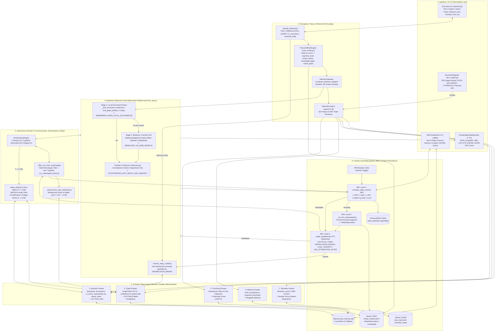

# EMA v3.4 — Episodic Memory & Metacognitive Agent

> **Repository Status:** Architecture & Technical Specification Release (`v3.4`). The complete formal specification, neurobiological mapping, and mathematical formulation are available now. Source code packaging is underway and will be released in staged milestones (see [Roadmap](#roadmap)).

> **Beyond stateless chatbots:** A neuro-symbolic cognitive architecture that decouples **executive self-regulation** from **text generation**—combining 5D Episodic Memory modeled after the hippocampal complex, a Multi-Hop Knowledge Graph, Homeostatic Drives, an Autonomous Stream of Consciousness with a silent Inner Scratchpad, Theory of Mind, and a Closed-Loop 6D Metacognitive Controller.

**Read the Full Technical Whitepaper:**
- [English Version (`WHITEPAPER.md`)](./WHITEPAPER.md)
- [Wersja Polska (`WHITEPAPER_PL.md`)](./WHITEPAPER_PL.md)

---

## Core Architectural Pillars

In typical LLM applications, "self-reflection" is an ephemeral textual illusion that vanishes once the context window closes. **EMA v3.4** reverses this hierarchy: the LLM serves solely as a semantic parser and natural-language realization organ, while persistent identity and behavioral control are governed by deterministic mathematical engines:

- **5-Dimensional Episodic & Semantic Memory (Hippocampal Model):** Simultaneous encoding across dense vector space (**Qdrant** 128D cosine), a multi-hop relational graph (**Neo4j** with dedicated `system:self`, `:MetaObservation`, and `:UserModel` nodes), and local audit storage with non-destructive belief revision (`is_active`, `superseded_by`).
- **Closed-Loop Metacognition (`MPL`):** Continuously tracks a **6D Meta-State Vector** (`emotional_volatility`, `epistemic_speculation`, `decision_reflectiveness`, `belief_stability`, `goal_starvation`, `environmental_friction`) in **TimescaleDB**, triggers structured LLM self-diagnosis on anomalies, and applies **TTL hysteresis controls** (`CAUTIOUS_TONE`, `DEPRECATION_BRAKE`, `GOAL_PRIORITY`, `VAD_ATTRIBUTION_FILTER`).
- **Theory of Mind & Silent Inner Scratchpad:** Models the interlocutor's knowledge level, goals, and communication style (`:UserModel`), while filtering internal monologue through a silent scratchpad before vocalizing thoughts aloud.
- **Homeostasis & Autonomous Thought Loop:** Regulated by **Curiosity**, **Cognitive Discomfort**, and **Computational Fatigue**. During idle periods, EMA spontaneously audits contradictions, verifies uncertain graph triples against Wikipedia, and enters **Auto-Sleep** to consolidate memory and crystallize new rules.
- **Document-First Epistemic Retrieval:** Multi-format ingestion (`.pdf`, `.docx`, `.txt`, `.md`, and remote `URL`) with strict epistemic priority—grounding answers in verified local knowledge before querying external web tools.

---

## High-Level System Architecture

*(Full architectural diagrams, neurobiological comparisons, sequence flows, and mathematical formulations are detailed in [`WHITEPAPER.md`](./WHITEPAPER.md) and [`WHITEPAPER_PL.md`](./WHITEPAPER_PL.md).)*

---

## Roadmap

- [x] **Milestone 1 — Theoretical Foundation & Architecture Specification (`v3.4`):** Formalization of the 5D hippocampal memory model, homeostatic drives, 6D Metacognitive Processing Loop (MPL), Theory of Mind, silent Inner Scratchpad, and hybrid Path A/Path B persistence design.
- **Milestone 2 — Core Cognitive Engine & Standalone Mode (Path A):** Release of the core Python runtime with local SQLite persistence, Ollama bridge, autonomous thought loop, and Sleep Phase consolidation.
- **Milestone 3 — Distributed Production Stack (Path B):** Release of Docker Compose orchestration (`TimescaleDB + Qdrant + Neo4j`), `APScheduler` integration, and Cypher multi-hop graph querying.
- **Milestone 4 — Observability Dashboard & Multi-Format Ingestion:** Release of the interactive Web UI (`Top-N` graph visualization, 6D telemetry charts, CSV/GraphML export) and PDF/DOCX/URL document loaders.

---

## Citation & Research

If you reference **EMA** or the **Metacognitive Processing Loop (MPL)** architecture in your research or engineering work, please cite [`WHITEPAPER.md`](./WHITEPAPER.md).

## License

This project is licensed under the **Apache License 2.0** — see the [`LICENSE`](./LICENSE) file for details.
