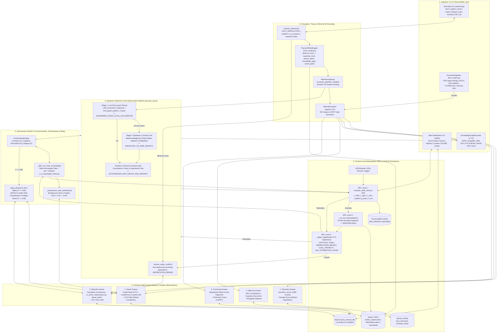
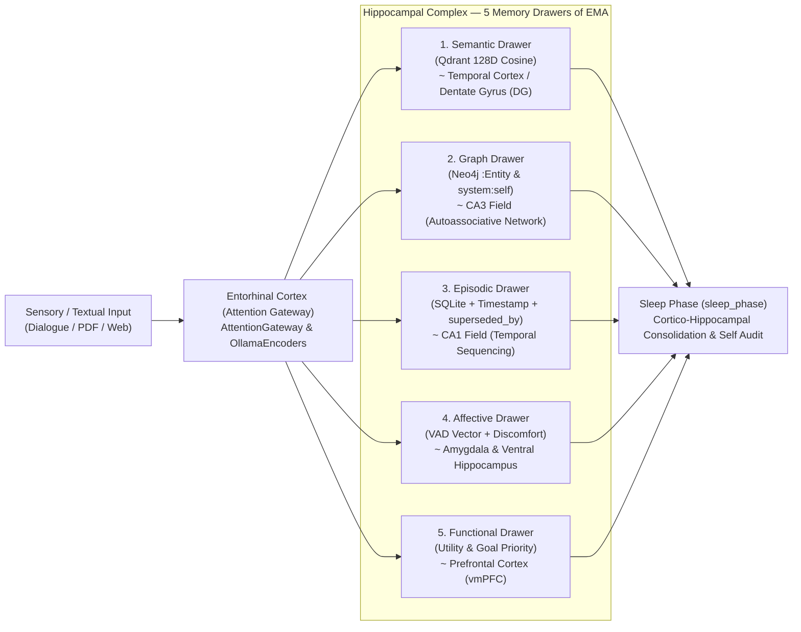
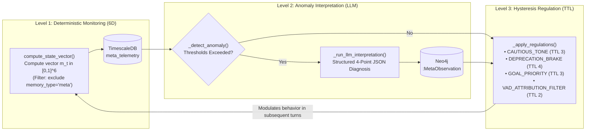

# EMA v3.4: Neuro-Symbolic Cognitive Architecture with Homeostatic Regulation, Closed-Loop Metacognition (MPL), and Theory of Mind

**Authors:** EMA Architecture Team  
**Version:** 3.4 (Architectural, Engineering & Neurobiological Specification Release)  
**Date:** November 2026  
**License:** Apache License 2.0  

---

## Abstract

Contemporary Large Language Models (LLMs) achieve remarkable results in statistical token prediction and surface-level textual reflection, yet from a cognitive systems engineering perspective they remain stateless, reactive, and devoid of persistent identity. Whenever a standard LLM claims uncertainty, emotional tension, or self-reflection, that behavior is merely an ephemeral linguistic artifact generated within a single context window rather than a grounded computational state.

This whitepaper defines **EMA (Episodic Memory Agent) v3.4**—a hybrid neuro-symbolic cognitive architecture in which **executive cognitive control** is strictly decoupled from **natural-language generation**. Within EMA, a local LLM operates solely as a semantic parser and speech-realization organ, while agency, autobiographical continuity, and self-regulation are governed by deterministic computational engines: a **5-Dimensional Episodic Memory modeled after the hippocampal complex**, a **Multi-Hop Knowledge Graph (Neo4j)**, a **Dense Vector Store (Qdrant)**, a **Homeostatic Drive Engine**, an **Autonomous Thought Loop with a silent Inner Scratchpad**, a **Theory of Mind module (`TheoryOfMindEngine`)**, and a **Three-Level Metacognitive Processing Loop (MPL)** backed by **TimescaleDB**.

---

## 1. System Architecture and Production Hybrid Stack

EMA v3.4 is engineered around a dual-mode persistence layer with seamless *graceful degradation*:
* **Path B (Distributed Production Stack):** Integrates **Qdrant** (128D cosine vector indexing with metadata filtering), **Neo4j 5** (property graph storing `:Entity`, `system:self`, `:MetaObservation`, and `:UserModel` nodes), **TimescaleDB** (time-series hypertables for the 6D MPL vector with `time_bucket` aggregations), and **APScheduler** (concurrent background execution).
* **Path A (Standalone Local Mode):** Zero-dependency fallback utilizing **SQLite** and lightweight Python daemon threads, preserving full cognitive operation when distributed container services are offline.



---

## 2. Neurobiological Analogy: Five Memory Drawers vs. The Hippocampal Complex

The `MemoryItem` data structure in EMA is not an arbitrary software partitioning; it is a functional engineering implementation of the human **hippocampal–entorhinal circuit (EC–DG–CA3–CA1)** responsible for memory consolidation, *pattern separation*, and *pattern completion*.



### Comparative Matrix: EMA Memory Drawers vs. Hippocampal Neurobiology

| EMA Drawer | Engineering Implementation | Neurobiological Counterpart | Functional Role in Cognition |
| :--- | :--- | :--- | :--- |
| **1. Semantic** (`semantic_vector`) | Dense 128D embeddings in **Qdrant** with cosine similarity and `memory_type` filtering. | **Dentate Gyrus (DG) & Temporal Neocortex** | **Pattern Separation:** Projects overlapping stimuli into an orthogonal vector space, enabling semantic retrieval even when exact lexical phrasing differs. |
| **2. Graph** (`GraphSlice` / `GraphTriple`) | `(Subject)–[Predicate]–>(Object)` triples in **Neo4j** with `confidence` weights and `system:self` node. | **Hippocampal CA3 Field (Recurrent Autoassociative Network)** | **Pattern Completion:** Multi-hop reconstruction of an entire causal or conceptual chain from a single cue entity (`find_graph_paths`). |
| **3. Episodic** (`MemoryMeta`) | ISO timestamp, `provenance` tag, `is_active` flag, `superseded_by` pointer, and `decay_factor`. | **Hippocampal CA1 Field (Time Cells)** | **Spatiotemporal Grounding & Continuity of "Self":** Preserves chronological order and non-destructive belief revision (the agent remembers *what* it previously believed and *why* it updated its stance). |
| **4. Affective** (`AffectiveSlice`) | Valence–Arousal–Dominance (VAD) coordinates coupled with cognitive discomfort in `HomeostasisEngine`. | **Amygdala & Ventral Hippocampus** | **Salience Tagging:** Amplifies memory traces associated with error or contradiction, shortening the idle silence threshold to prioritize conflict resolution. |
| **5. Functional** (`FunctionalSlice`) | Operational utility scores, alignment with user goals, and `goal_starvation` tracking. | **Ventromedial Prefrontal Cortex (vmPFC)** | **Value-Based Gating:** Selects memories relevant to active operational tasks while suppressing unproductive background speculation. |

---

## 3. Engineering Specification of Core Functions and Algorithms

### 3.1 Cognitive Orchestration & Epistemic Hierarchy (`NaturalLearningOrchestrator`)
* **`classify_utterance(text: str) -> dict`:** Deterministic-semantic input classifier. Identifies conversational intent (`FACT`, `RESOLUTION`, `QUERY`), detects user pushback (`is_correction`), and extracts target entities requiring state updates (`resolved_entity`).
* **`resolve_entity_conflict(entity_hint, new_memory_id, is_explicit_resolution) -> int`:** Non-destructively archives superseded beliefs (`is_active = False`, `superseded_by = new_memory_id`, reducing `decay_factor` by 90%) simultaneously across **SQLite**, **Qdrant**, and **Neo4j**. Protected by the metacognitive **`DEPRECATION_BRAKE`**.
* **`process_query(query: str) -> OrchestratorResponse`:** Enforces a strict three-stage epistemic retrieval pipeline:
  1. **Local Document Priority (`_find_document_evidence` + `_get_neo4j_graph_context`):** Queries vectors originating from ingested documents (`provenance: "doc:*"`) in Qdrant (`score >= 0.30`) alongside 1–3 hop relationship paths in Neo4j (`ANSWERED_FROM_LOCAL_DOCUMENTS`).
  2. **Epistemic Curiosity (`WebKnowledgeTool.execute`):** Queries **Open-Meteo** or **Wikipedia** when local documents lack coverage (`RESOLVED_VIA_WEB_SEARCH`).
  3. **Observer-Supervised Cautious Synthesis:** Fuses top Qdrant vectors (excluding `memory_type="meta"`) with Neo4j graph paths (`SYNTHESIZED_WITH_NEO4J_AND_QDRANT`).

``````mermaid
sequenceDiagram
    actor User
    participant Orch as NaturalLearningOrchestrator
    participant ToM as TheoryOfMindEngine
    participant Qdrant as Qdrant (128D)
    participant Neo4j as Neo4j (Graph)
    participant Web as WebKnowledgeTool
    participant MPL as MPL Controller

    User->>Orch: Submit Query (QUERY)
    Orch->>ToM: observe_turn() & get_prompt_context()
    Orch->>Qdrant: 1. Search local documents (provenance="doc:*")
    Orch->>Neo4j: 1. Traverse 1..3 hop paths (find_graph_paths)
    alt Strong Local Document Match (score >= 0.30)
        Qdrant-->>Orch: Publication Chunks
        Neo4j-->>Orch: Entity Relationship Paths
        Orch-->>User: Grounded Response [ANSWERED_FROM_LOCAL_DOCUMENTS]
    else No Local Document Match
        Orch->>Web: 2. Check Open-Meteo / Wikipedia
        alt External Data Retrieved
            Web-->>Orch: Verified Text
            Orch->>Qdrant: Persist New Knowledge (web_search)
            Orch-->>User: Synthesized Response [RESOLVED_VIA_WEB_SEARCH]
        else Unavailable / Vetoed by Observer
            Orch->>Qdrant: 3. General RAG (exclude_meta=True)
            Orch->>Neo4j: 3. Multi-Hop Graph Context
            Orch-->>User: Cautious Synthesis [SYNTHESIZED_WITH_NEO4J_AND_QDRANT]
        end
    end
    Orch->>MPL: run_cycle(trigger="turn_query")
```
```

### 3.2 Three-Level Metacognitive Processing Loop (`MetacognitiveProcessingLoop`)



* **Level 1 (`compute_state_vector`):** Computes $\mathbf{m}_t = [v_{\text{VAD}}, r_{\text{spec}}, r_{\text{refl}}, s_{\text{belief}}, g_{\text{starv}}, f_{\text{env}}]^T \in [0,1]^6$ strictly from deterministic telemetry.
* **Level 2 (`_run_llm_interpretation`):** Generates a 4-point structured self-diagnosis persisted as a `:MetaObservation` node in Neo4j upon threshold breaches.
* **Level 3 (`_apply_regulations`):** Applies turn-bounded TTL hysteresis controls (`CAUTIOUS_TONE`, `DEPRECATION_BRAKE`, `GOAL_PRIORITY`, `VAD_ATTRIBUTION_FILTER`).

### 3.3 Theory of Mind (`TheoryOfMindEngine`) & Silent Inner Scratchpad
* **`observe_turn(client, user_text, intent, is_correction)`:** Maintains a persistent **`(:UserModel)`** node in **Neo4j** tracking `expertise_level`, `preferred_style`, `known_topics`, `knowledge_gaps`, and `active_goals`.
* **`_filter_via_inner_scratchpad(draft_thought, category)`:** Evaluates idle thoughts in a silent scratchpad (`CICHA MYŚL (SCRATCHPAD)`) before speaking aloud, while `_is_meaningful_memory` isolates ingested documents (`doc:*`) from self-identity contradiction checks.

---

## 4. Summary of Emergent Cognitive Properties

| Cognitive System Criterion | Implementation in EMA v3.4 | Verifiable Engineering Artifact |
| :--- | :--- | :--- |
| **Self & Other Modeling** | Strict separation between **`system:self`** and **`:UserModel`** (interlocutor knowledge & goals). | Neo4j Cypher queries & `/tom` command. |
| **Recursive Self-Modeling** | Processing information about internal processing (6D state vector $\to$ `:MetaObservation` $\to$ TTL regulation). | TimescaleDB hypertable & `/eksport_mpl` CSV export. |
| **Information Integration & Memory** | Simultaneous 5D synchronization across Qdrant, Neo4j, TimescaleDB, and SQLite with `superseded_by` chains. | `ProductionHybridStorage` adapter layer. |
| **Behavioral Flexibility & Control** | Hypothesis vetoing via `Observer`, `DEPRECATION_BRAKE`, `CAUTIOUS_TONE`, and silent `Inner Scratchpad`. | Observer flags & Web Dashboard v2.4 logs. |
