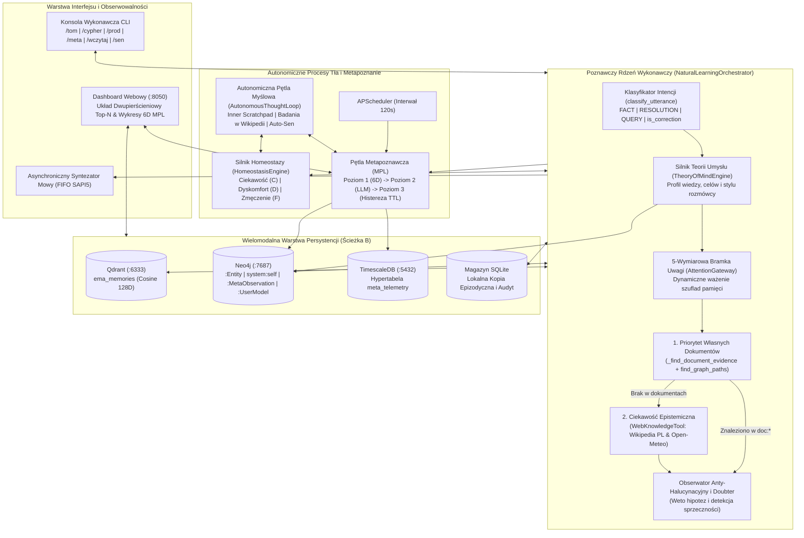
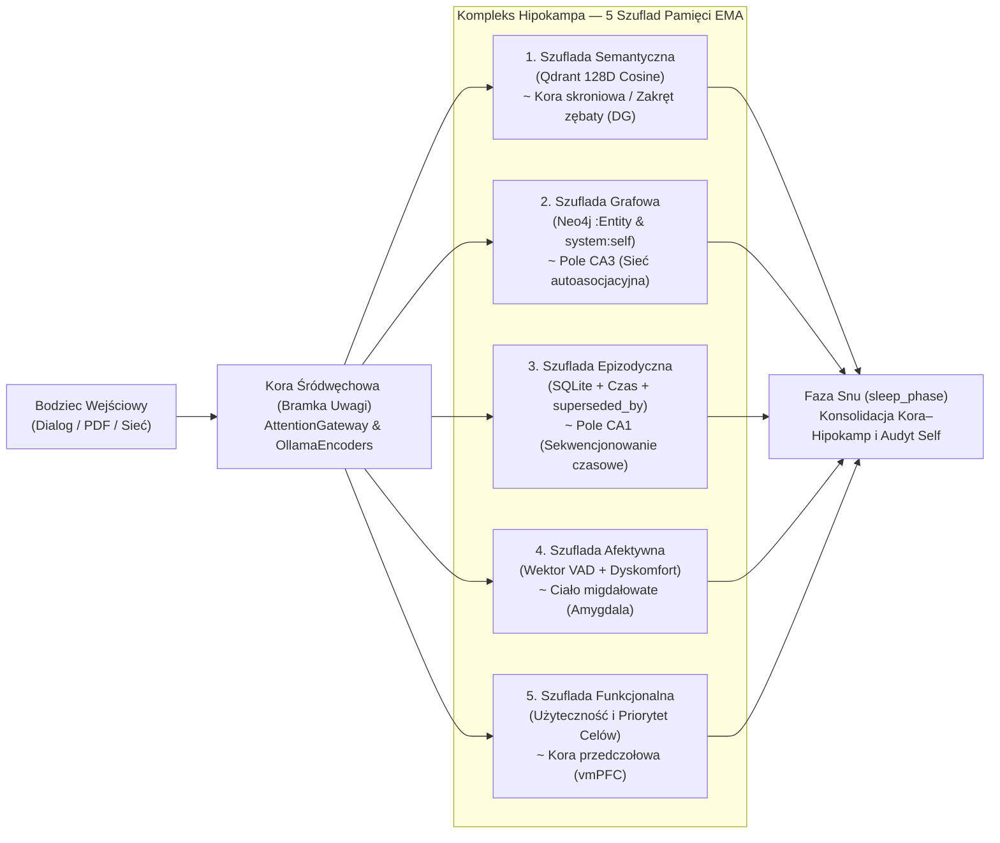

# EMA v3.4: Neuro-Symboliczna Architektura Poznawcza z Regulacją Homeostatyczną, Zamkniętą Pętlą Metapoznawczą (MPL) i Teorią Umysłu

**Autorzy:** EMA Architecture Team  
**Wersja:** 3.4 (Wydanie Specyfikacji Architektonicznej, Inżynieryjnej i Neurobiologicznej)  
**Data:** Listopad 2026  
**Licencja:** Apache License 2.0  

---

## Streszczenie (Abstract)

Współczesne duże modele językowe (LLM) osiągają imponujące wyniki w statystycznym przewidywaniu tokenów i powierzchownej autorefleksji tekstowej, jednak z punktu widzenia inżynierii systemów poznawczych pozostają układami bezstanowymi, reaktywnymi i pozbawionymi trwałej tożsamości. Wszelkie deklaracje niepewności, emocji czy namysłu generowane przez standardowy model językowy są wyłącznie ulotnymi artefaktami językowymi w obrębie pojedynczego okna kontekstowego.

Niniejszy dokument definiuje **EMA (Episodic Memory Agent) v3.4** — hybrydową, neuro-symboliczną architekturę poznawczą, w której **wykonawcza kontrola poznawcza** jest rygorystycznie oddzielona od **generowania języka naturalnego**. W systemie EMA lokalny model LLM pełni wyłącznie funkcję parsera semantycznego i aparatu mowy, podczas gdy sprawczość, ciągłość tożsamości i samoregulacja są realizowane przez deterministyczne silniki obliczeniowe: **5-wymiarową pamięć epizodyczną wzorowaną na kompleksie hipokampa**, **wieloskokowy Graf Wiedzy (Neo4j)**, **gęsty magazyn wektorowy (Qdrant)**, **silnik homeostazy**, **autonomiczną pętlę myślową z cichym brudnopisem (*Inner Scratchpad*)**, **moduł Teorii Umysłu (`TheoryOfMindEngine`)** oraz **trójpoziomową pętlę metapoznawczą (MPL)** opartą na **TimescaleDB**.

---

## 1. Architektura Systemu i Hybrydowy Stos Produkcyjny

System EMA v3.4 został zaprojektowany w architekturze dwutrybowej z automatycznym mechanizmem przełączania awaryjnego (*graceful degradation*):
* **Ścieżka B (Rozproszony stos produkcyjny):** Wykorzystuje **Qdrant** (indeksowanie wektorowe Cosine 128D z filtrowaniem metadanych), **Neo4j 5** (graf właściwości przechowujący węzły `:Entity`, `system:self`, `:MetaObservation` oraz `:UserModel`), **TimescaleDB** (hypertabele szeregów czasowych dla wektora 6D MPL z agregacją `time_bucket`) oraz **APScheduler** (harmonogram zadań w tle).
* **Ścieżka A (Samodzielny tryb lokalny):** Bezobsługowy tryb zapasowy oparty na bazie **SQLite** oraz wątkach demonów standardowej biblioteki Pythona.

---

## 2. Neurobiologiczna Analogia: Pięć Szuflad Pamięci EMA a Kompleks Hipokampa

Projekt struktury danych `MemoryItem` w EMA stanowi inżynieryjną implementację funkcjonalną ludzkiego **układu hipokampa i kory śródwęchowej (EC–DG–CA3–CA1)** odpowiedzialnego za konsolidację śladów pamięciowych, separację wzorców (*pattern separation*) oraz dopełnianie wzorców (*pattern completion*).

### Tabela Porównawcza: Szuflady Pamięci EMA vs. Neurobiologia Hipokampa

| Szuflada w EMA | Implementacja Inżynieryjna | Odpowiednik Neurobiologiczny | Rola Funkcjonalna w Procesie Poznawczym |
| :--- | :--- | :--- | :--- |
| **1. Semantyczna** (`semantic_vector`) | Gęste wektory osadzeń (128D) w **Qdrant** z metryką kosinusową i filtrowaniem `memory_type`. | **Zakręt zębaty (Dentate Gyrus — DG) oraz Kora Skroniowa** | **Separacja wzorców (*Pattern Separation*):** Rzutowanie podobnych bodźców do ortogonalnej przestrzeni wektorowej, pozwalające odnaleźć znaczenie nawet przy zupełnie innym doborze słów. |
| **2. Grafowa** (`GraphSlice` / `GraphTriple`) | Relacje `(Podmiot)–[Predykat]–>(Obiekt)` w **Neo4j** z wagą `confidence` i węzłem `system:self`. | **Pole CA3 Hipokampa (Rekurencyjna sieć autoasocjacyjna)** | **Dopełnianie wzorców (*Pattern Completion*):** Wieloskokowe odtwarzanie całego łańcucha przyczynowego na podstawie pojedynczego pojęcia-klucza (`find_graph_paths`). |
| **3. Epizodyczna** (`MemoryMeta`) | Znacznik czasu ISO, źródło (`provenance`), flaga `is_active`, wskaźnik `superseded_by` oraz `decay_factor`. | **Pole CA1 Hipokampa (Komórki czasu — *Time Cells*)** | **Osadzenie czasoprzestrzenne i ciągłość „Ja”:** Utrzymanie chronologii zdarzeń oraz niedestrukcyjna rewizja wiedzy (agent pamięta, co myślał wcześniej i dlaczego zmienił zdanie). |
| **4. Afektywna** (`AffectiveSlice`) | Współrzędne Walencja–Pobudzenie–Dominacja (VAD) sprzężone z dyskomfortem w `HomeostasisEngine`. | **Ciało migdałowate (Amygdala) oraz Hipokamp brzuszny** | **Modulacja istotności (*Salience Tagging*):** Wzmacnianie śladów związanych z błędem lub sprzecznością, co skraca próg ciszy i wymusza priorytetową weryfikację konfliktu. |
| **5. Funkcjonalna** (`FunctionalSlice`) | Wagi użyteczności operacyjnej, powiązanie z celami użytkownika i wskaźnik `goal_starvation`. | **Brzuszno-przyśrodkowa Kora Przedczołowa (vmPFC)** | **Wartościowanie decyzyjne:** Selekcja wspomnień użytecznych dla bieżącego zadania oraz hamowanie jałowych spekulacji w pętli tła. |

---

## 3. Opis Inżynieryjny Kluczowych Funkcji i Algorytmów

### 3.1 Rdzeń Orkiestracji i Hierarchia Epistemiczna (`NaturalLearningOrchestrator`)
* **`classify_utterance(text: str) -> dict`:** Klasyfikator wejścia rozpoznający intencję (`FACT`, `RESOLUTION`, `QUERY`), korekty (`is_correction`) oraz podmiot wymagający aktualizacji (`resolved_entity`).
* **`resolve_entity_conflict(...) -> int`:** Niedestrukcyjnie wygasza nieaktualne przekonania równolegle w **SQLite**, **Qdrant** i **Neo4j**, chroniona hamulcem `DEPRECATION_BRAKE`.
* **`process_query(query: str) -> OrchestratorResponse`:** Realizuje trzystopniowy potok ugruntowania wiedzy:
  1. **Priorytet Dokumentów Lokalnych (`ANSWERED_FROM_LOCAL_DOCUMENTS`):** Wyszukiwanie wektorowe w `doc:*` (Qdrant) + 1–3 skokowe ścieżki w Neo4j.
  2. **Ciekawość Epistemiczna (`RESOLVED_VIA_WEB_SEARCH`):** Open-Meteo / Wikipedia PL przy braku danych lokalnych.
  3. **Synteza Ostrożna (`SYNTHESIZED_WITH_NEO4J_AND_QDRANT`):** Synteza pod nadzorem `Observer` z wykluczeniem `memory_type="meta"`.

### 3.2 Trójpoziomowa Pętla Metapoznawcza (`MetacognitiveProcessingLoop`)
* **Poziom 1 (`compute_state_vector`):** Oblicza 6-wymiarowy wektor $\mathbf{m}_t = [v_{\text{VAD}}, r_{\text{spec}}, r_{\text{refl}}, s_{\text{belief}}, g_{\text{starv}}, f_{\text{env}}]^T \in [0,1]^6$ bez udziału LLM.
* **Poziom 2 (`_run_llm_interpretation`):** Generuje 4-punktową diagnozę zapisywaną jako węzeł `:MetaObservation` w Neo4j.
* **Poziom 3 (`_apply_regulations`):** Nakłada korekty TTL z histerezą (`CAUTIOUS_TONE`, `DEPRECATION_BRAKE`, `GOAL_PRIORITY`, `VAD_ATTRIBUTION_FILTER`).

### 3.3 Teoria Umysłu (`TheoryOfMindEngine`) i Cicha Mowa Wewnętrzna (`Inner Scratchpad`)
* **`observe_turn(...)`:** Utrzymuje w **Neo4j** węzeł **`(:UserModel)`** z poziomem wiedzy (`expertise_level`), stylem (`preferred_style`), tematami opanowanymi (`known_topics`), lukami (`knowledge_gaps`) i celami (`active_goals`).
* **`_filter_via_inner_scratchpad(...)`:** Filtruje myśli w cichym brudnopisie (`CICHA MYŚL (SCRATCHPAD)`) przed ich wypowiedzeniem na głos, a `_is_meaningful_memory` izoluje akapity książek (`doc:*`) od detekcji konfliktów tożsamościowych.

---

## 4. Podsumowanie Właściwości Emergentnych Systemu

| Kryterium Systemu Poznawczego | Realizacja w EMA v3.4 | Weryfikowalny Artefakt Techniczny |
| :--- | :--- | :--- |
| **Modelowanie siebie i innych** | Rozdzielenie węzła **`system:self`** od węzła **`:UserModel`**. | Zapytania Cypher w Neo4j oraz komenda `/tom`. |
| **Modelowanie rekurencyjne** | Przetwarzanie informacji o własnym przetwarzaniu (wektor 6D $\to$ `:MetaObservation` $\to$ regulacja TTL). | Szereg czasowy w TimescaleDB + eksport `/eksport_mpl`. |
| **Integracja informacji i pamięć** | Jednoczesna synchronizacja 5 wymiarów pamięci w Qdrant, Neo4j, TimescaleDB i SQLite. | Hybrydowy magazyn `ProductionHybridStorage`. |
| **Elastyczność i kontrola** | Wetowanie halucynacji przez `Observer`, `DEPRECATION_BRAKE`, `CAUTIOUS_TONE` oraz `Inner Scratchpad`. | Flagi diagnostyczne Obserwatora oraz logi Dashboardu. |
